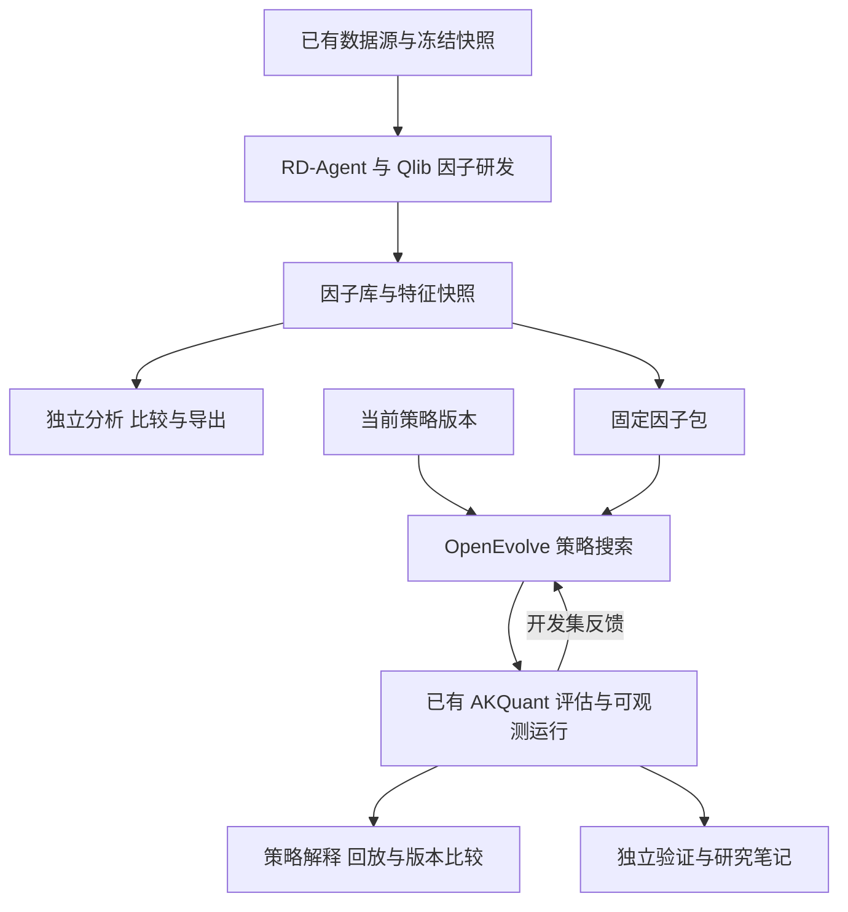

将现有 TradeGrad fork 中的 WebUI 和研究证据平台迁移为以 RD-Agent 研发因子、以 OpenEvolve 演化策略的工作台。因子是可以独立保存、解释、比较、导出和复用的研究产物；策略界面首先呈现做什么、改了什么和实际影响，再提供代码与运行细节。

本轮范围是迁移计划。实施继续沿用现有 fork；新研究流程以 RD-Agent 和 OpenEvolve 为主，历史 TradeGrad 结果保留原始解释。交易执行、数据快照、回放、对照与笔记尽量复用已经实现的底座。

# 一 产品目标与实施基线

## 产品目标

用户打开一个因子或策略版本后，应能快速回答四个问题：它现在做什么；相对父版本改了什么；改动实际改变了哪些计算或交易；哪些结论来自运行或对照证据，哪些只是模型的解释。

首版交付必须同时完成独立因子库、OpenEvolve 搜索、RD-Agent 因子接入以及至少一个可以贯通因子变化和交易变化的例子。只跑通两个 CLI 或展示净值曲线不构成本次交付完成。

## 当前仓库基线

以 [idkwhodatis/TradeGrad 的 master 提交 6828f3b](https://github.com/idkwhodatis/TradeGrad/tree/6828f3bd429fc754648021bae703a14fa300b62e) 为本计划的代码基线，核对日期为 2026 年 10 月 24 日。完整提交为 `6828f3bd429fc754648021bae703a14fa300b62e`。

现有策略理解增量已经合入，包括规则卡片、规则图、决策回放、机制比较、谱系、独立验证和版本化笔记。核对时，该提交的 [V1 staged validation 40134103045](https://github.com/idkwhodatis/TradeGrad/actions/runs/40134103045) 仍在运行；上一轮的 completed-evidence cold restore 失败与后续修正记录在 [研究增量验收记录](https://github.com/idkwhodatis/TradeGrad/blob/6828f3bd429fc754648021bae703a14fa300b62e/docs/V1_RESEARCH_INCREMENT.md)。功能已实现与当前提交完成整体验收是两种状态。在线数据源验收也继续独立记录。

实施开始时读取实际 master，记录与本基线的差异并确认已有 CI 的终态；只处理仍然存在的失败，不重复宣布历史已完成工作为新任务。

## 主要决策

1. 保留现有仓库和应用底座，不建立另一套独立 WebUI。

2. 新建策略研究默认使用 OpenEvolve；RD-Agent 负责上游因子研发。

3. 因子库拥有独立于临时 workspace 和搜索引擎的持久化生命周期。

4. 把可解释的计算、阶段输入输出和版本变化作为主要交付能力。

5. 保留 AKQuant 执行与账务、现有原生和 portable 兼容路径。

6. 先支持因子研发路径；RD-Agent 模型研发、因子与策略联合变异、实盘映射留作后续扩展。

OpenEvolve 的通用程序演化能力适合作为主搜索引擎；框架成熟度本身不代表其生成的量化策略已经获得收益验证。评估协议继续由本平台明确约束。

# 二 现有能力的复用范围

| 模块 | 当前实现 | 本次处理 |
| --- | --- | --- |
| 认证 路由 设置 数据源 | 已有 React 与 FastAPI 应用 | 保留业务行为，调整产品名称和导航 |
| 数据快照和证券范围 | 已有不可变版本、导入和来源信息 | 作为 RD-Agent 和 OpenEvolve 的共同数据入口 |
| 策略研究工作台 | 已有五个标签及谱系侧栏 | 加概览卡、因子依赖、OpenEvolve 上下文 |
| 决策回放 | 已有事件、证券、阶段、条件、委托和成交关系 | 扩展因子版本、特征快照和实际读取记录 |
| 机制和行为比较 | 已有代码、配置、双边前置状态、行为和覆盖差异 | 增加因子定义及使用方式差异 |
| 独立验证和笔记 | 已有诊断重跑、两至三组对照、版本化笔记和证据固定 | 扩展因子证据和因子相关实验 |
| 任务和运行 | 已有队列、outbox、租约、隔离运行、事件和恢复 | 复用生命周期，拆开算法专属部分 |
| 存储与维护 | 已有 artifact 校验、Parquet、保留、备份和恢复 | 纳入因子、依赖与分析产物 |
| TradeGrad 优化器 | 当前新研究仍依赖 TradeTGD 配置与 checkpoint | 从新流程退出，保留必要的历史读取代码 |
| 因子库与 RD-Agent 接入 | 当前没有独立实现 | 新增 |
| OpenEvolve 接入 | 当前没有独立实现 | 新增 |

直接复用的前端基础见 [现有研究工作台](https://github.com/idkwhodatis/TradeGrad/blob/6828f3bd429fc754648021bae703a14fa300b62e/frontend/src/features/research-workbench/page.tsx) 和 [已安装组件](https://github.com/idkwhodatis/TradeGrad/blob/6828f3bd429fc754648021bae703a14fa300b62e/frontend/package.json)。React Flow、Monaco、ECharts、Lightweight Charts、TanStack 和现有 UI primitives 都已经存在，无需为迁移另换图表或 UI 框架。

# 三 目标架构

FastAPI、PostgreSQL、Procrastinate 继续负责控制面、身份、任务和证据；Parquet 与 DuckDB 承担大规模因子值和有界查询。RD-Agent、OpenEvolve、Qlib 与策略执行分别运行在固定依赖环境中，候选程序通过已有隔离执行边界运行。

两个研究引擎只负责各自的搜索逻辑。平台负责输入版本、预算、运行记录、评估协议、产物发布和可视化，不再加一个负责重新决策的 agent 框架。

Qlib 保留为 RD-Agent 的研究依赖。OpenEvolve 使用现有策略执行体系，因子分析和最终策略执行的指标含义分别保存。

# 四 信息架构与首屏

主导航围绕产物和研究工作组织：研究概览、因子库、策略库、研究运行、数据、设置。对照验证从因子或策略详情进入，已有直接链接保持可用。RD-Agent 与 OpenEvolve 显示在来源与运行详情中。

当前 [布局](https://github.com/idkwhodatis/TradeGrad/blob/6828f3bd429fc754648021bae703a14fa300b62e/frontend/src/components/layout.tsx) 的 TradeGrad 品牌和固定 Seed evaluation 标签需要改为准确的工作区与运行状态。

## 三层阅读方式

| 层次 | 先回答的问题 | 展示方式 |
| --- | --- | --- |
| 概览 | 这是什么 本轮改了什么 | 一句话含义、输入输出、父版本变化、主要观察 |
| 机制 | 它怎样计算 怎样形成交易 | 计算步骤、阶段图、真实样本、联动回放 |
| 证据 | 这些说明是否可复现 | 源码、代码 hash、数据版本、评估、原始 artifacts |

现有 UUID、hash、manifest 与精确绑定继续保留，放入可展开的证据详情。结果、描述和图始终绑定选中的准确版本，不因折叠信息而放松校验。

每个版本的变化卡采用相同结构：改动目的、实际改动、观察结果、代价和证据入口。模型提出的改动目的明确标注来源；实际观察必须链接到保存的样本、评估或执行事件。

# 五 独立因子库

## 因子是一等研究产物

因子无需被策略采用，也无需启动 OpenEvolve，就可以保存、查看、比较、收藏、分析和导出。RD-Agent 每次生成或修复的版本都保留；失败版本保存代码与错误，可计算但未采用的版本保存其有效产物。默认列表可筛选可用版本，历史中仍能查看被淘汰的方向。

列表展示名称、含义、版本、横截面或时间序列类型、频率、来源、数据范围、计算状态、覆盖率、固定协议下的主要评价、被哪些策略引用，以及最近一次变化。策略引用数、实际读取数和有增益证据的次数分别统计。

建议入口为 `/factors` 和 `/factors/{factorId}/versions/{versionId}`。latest 仅用于浏览和选择；运行、笔记和导出固定具体版本。

## 详情页

| 标签 | 内容 | 主要交互 |
| --- | --- | --- |
| 概览与计算 | 含义、公式、输入、回看期、滞后、方向、计算范围、父版本变化 | 选择证券与日期，查看真实计算实例 |
| 数值行为 | 时间序列、横截面分布、排名、缺失、极值、覆盖 | 图表和因子值表联动，切换原始与处理后视图 |
| 研究评价 | 直接因子 IC、Rank IC、分组表现、相关性与稳定性 | 固定 label、horizon、数据与评估窗口后比较 |
| 演化历史 | 父子关系、代码与参数差异、输出值变化、成功与失败 | 选两个版本，在相同输入和协议下对比 |
| 策略使用 | 可用依赖、实际读取、参与的阶段、相关对照 | 跳到策略版本和具体决策 |
| 代码与证据 | Python、来源、原生报告、manifest、笔记、导出 | 查看或下载不可变产物 |

不具备对应产物的指标显示未评估或不适用。单只证券的时间序列不能直接套用横截面 IC 或分组图的统计含义。

## 计算可视化示例

以下仅说明界面需要表达的变化，不代表实际研发结果：

| 版本 | 定义示意 | 用户应理解的变化 |
| --- | --- | --- |
| v1 | 过去 20 个交易日的收益 | 偏好近期上涨的证券 |
| v2 | 20 日收益除以同期日收益波动 | 在相近涨幅下偏好波动较低的证券 |
| v3 | 对 v2 在指定证券范围内排名 | 将不同证券的数值转成同一截面的相对位置 |

计算图可展示价格与收益、波动计算、组合及排名的关系。只有与执行代码和已知算子绑定的步骤才标为可验证；任意 Python 内部未映射的计算显示为自定义节点，并提供输入、输出和源码。不能把模型生成的公式图当作实际执行证明。

真实计算实例应提供所选日期的有效窗口、输入值、输出、缺失原因和可用时间。除零、样本不足、异常处理和截面成员变化需要可见。

## 独立分析的复用

优先复用 Qlib 的 [calc_ic 与相关分析函数](https://github.com/microsoft/qlib/blob/main/qlib/contrib/eva/alpha.py)，由平台固定指标版本、标签定义、持有期、证券范围、缺失策略和窗口，再用已有 ECharts 绘制。

区分三类评价：直接因子评价、使用因子的模型预测评价、模型或策略形成组合后的评价。Qlib 的原生 score IC 是 prediction score 与 label 的相关性；其报告中的累计收益还存在收益求和的约定。因此保留原生报告的含义，统一图表需要明确对象与累计方式，不把原生报告直接冒充单因子 IC 或另一引擎的复利净值。参见 [Qlib 报告文档](https://qlib.readthedocs.io/en/latest/component/report.html)。

# 六 策略与迭代可视化

## 复用现有工作台

保留 Description、Decision replay、Version comparison、Verification、Notes 及谱系侧栏。新增的重点是概览、因子身份、演化上下文和生成代码的观测覆盖，而不是重做这些功能。

策略首屏显示：策略目标与适用范围；信号、筛选、打分、分配和风险阶段；相对父版本的变化；实际观察到的排名、仓位或交易变化；解释覆盖程度和证据入口。

例如某个候选从动量排序改为风险调整动量，再添加流动性过滤，界面应分别展示因子依赖、打分逻辑与资格条件变化，并允许跳到某个真实决策，查看被过滤的证券、剩余排名、目标权重及执行结果。

## 三种互相连接的视图

| 视图 | 核心问题 | 展示内容 |
| --- | --- | --- |
| 机制图 | 策略按什么阶段形成决策 | 固定阶段、实际输入输出、可识别条件、未映射自定义计算 |
| 决策回放 | 在这一刻为什么形成这个结果 | 当时可用因子、候选集合、分数排名、目标、约束、委托与成交 |
| 演化与比较 | 这轮究竟改变了什么 | 提议、实际代码与依赖变化、固定协议观察、保留或淘汰状态 |

同一游标联动行情、因子值、排名、持仓与委托。横截面决策保持组合级 decision ID，不把一次调仓拆成互不关联的单股决策。未触发、目标未变、被约束阻止、委托未成交是不同情况。

父子版本对照保留双方前置持仓和资金状态。历史路径不同导致的持仓差异，不能直接归因于本轮某个因子变化；需要固定条件的额外实验才能判断增量。

## OpenEvolve 的搜索过程

版本时间线优先于复杂全局大图。每个候选显示真实父程序、参考候选、代码、依赖、评分及评价协议、状态和修改说明。island 与 archive 是搜索状态，不是父子继承关系。失败候选和被淘汰候选仍进入研究历史。

首版使用父子树加依赖抽屉，必要时展开小范围参考关系。MAP-Elites 的搜索行为维度单独命名，不与金融因子混用；完整多维搜索地图不作为第一版的发布门槛。

# 七 让演化后的策略保持可观测

## 当前限制

现有模板图主要依赖完整源码与维护模板相等；修改后的代码会退回部分映射。当前 portable.v1 也没有因子字段，内部特征和条件不能自动获得完整执行轨迹。依据为 [描述与模板识别](https://github.com/idkwhodatis/TradeGrad/blob/6828f3bd429fc754648021bae703a14fa300b62e/packages/research_trace/specification.py)、[portable 轨迹边界](https://github.com/idkwhodatis/TradeGrad/blob/6828f3bd429fc754648021bae703a14fa300b62e/packages/research_trace/portable.py) 及 [现有 SDK](https://github.com/idkwhodatis/TradeGrad/blob/6828f3bd429fc754648021bae703a14fa300b62e/packages/strategy_sdk/README.md)。

因此仅接入 OpenEvolve，会出现每轮代码发生有意义变化后，规则图就失去适用性的情况。可观测运行 profile 必须与引擎接入同步交付。

## 固定宿主与可演化函数

在现有 portable 隔离执行、JSON frame、状态 codec 和 AKQuant controller 上新增一个版本化 profile。宿主按明确顺序调用资格、打分、分配等阶段，候选编写这些阶段内的 Python 函数；最终风险边界、撮合、费用和账务由固定运行时处理。

候选可修改计算逻辑，不限于参数调优。新 profile 为允许使用的 NumPy 和 pandas 单独锁定依赖，构建新的 policy 镜像和环境 digest，并验证内存、启动和超时边界；现有最小 portable.v1 镜像保持不变。在新 profile 支持的依赖内，自定义计算可以运行，其内部未结构化部分以自定义计算节点展示。StrategySpec 继续是说明、来源位置与覆盖合同，不变成另一套执行策略语言。

新 profile 增加过去时点可用的因子视图，以及 stage-call 和 stage-reply 合同。一个 evaluation 使用一个常驻 policy sandbox 处理各阶段，复用已有进程边界；不为每个阶段重新启动容器。

可用时点由可信宿主根据当前决策确定，候选不能自行把查询时间推进到未来。完整特征面板留在宿主侧，候选只接收当前允许的数据投影或有界访问响应，不直接挂载全时期的因子缓存。

可信 controller 要实际消费返回的资格 mask、分数或目标，并记录阶段输入输出。只在候选子进程内加日志 helper，得到的仍然是策略自报，不能升级为宿主观测。

## 证据等级

| 信息 | 可展示的结论 |
| --- | --- |
| 因子列在允许使用的 FactorBundle 中 | 本轮可用 |
| 宿主为显式因子请求保存访问回执 | 已请求或读取过 |
| 宿主消费了阶段结果并推进后续决策 | 可以追踪该结果进入决策链 |
| 候选自行输出解释日志 | 策略自报说明 |
| 模型总结代码 | 模型解释或假设 |
| 固定协议的对照实验 | 对该协议和样本下的增量提供证据 |

计算过但丢弃的结果不画成影响仓位的执行边；读取因子也不自动等于因子有贡献。未执行、未知、未采集与 false 保持不同状态。

整批因子视图交付给阶段，只能证明已提供，不能证明候选索引了每一列。只有明确的逐因子访问回执才计入读取统计；子进程自报的访问保持策略自报来源。宿主消费阶段输出，也不能单独证明某个输入因子对该输出有贡献。

默认新建研究优先使用可观测日频 profile。原生 native_akquant 路径用于兼容或阶段性集成验证，保留其代码和引擎同进程的证据等级。原有 portable 的频率、证券数量、历史长度、价格与公司行为准入边界继续适用；扩容另行验证，不能用 trace 存储容量证明策略执行容量。

现有 native 策略可直接作为 OpenEvolve 兼容模式的起点。转换到阶段式 profile 时创建新的 StrategyVersion，记录来源，并在固定数据、费用和可比执行条件下进行基线行为对照；无法保持等价的执行时点或逻辑明确显示差异，作为新的研究起点。转换不覆盖原代码，也不把模型自动转换声明为语义等价。

# 八 因子数据与持久化合同

| 对象 | 主要内容 | 不可变边界 |
| --- | --- | --- |
| Factor | 逻辑名称、分类、收藏和展示信息 | 名称变化不修改历史定义 |
| FactorVersion | 定义、代码 hash、父版本、输入、参数、来源与解释来源 | 修改公式或代码产生新版本 |
| FeatureSnapshot | 因子版本在特定输入上的值、来源、覆盖及输出 hash | 数据或计算环境变化产生新快照 |
| FactorEvaluation | 具体计算或分析执行、协议、窗口、指标和证据 | 每次实际执行独立留痕 |
| FactorBundle | 一组因子版本和使用约束 | 搜索开始前固定 |
| StrategyDependency | 策略与因子、预处理、快照的关系 | 依赖变化产生新策略版本或运行配置 |

FactorEvaluation 使用专门的因子 payload，不伪造交易次数、订单或净值。原始因子、预处理特征和模型预测保持不同类型；第一版聚焦因子，已有预处理则保留其方法和拟合产物。

FeatureSnapshot 至少固定：FactorVersion、DatasetVersion、计算证券范围、频率、时区、时间范围、回看与滞后、价格语义、输入字段和单位、缺失策略、预处理版本及拟合窗口、运行环境和输出 hash。

因子值至少以时间、证券、因子版本及可用时间关联。计算截面与最终交易证券范围分开保存；不能因执行容量限制而缩小因子计算截面，再声称值没有变化。

使用 PostgreSQL 保存元数据、权限与关系，Parquet 保存数值和分析序列，DuckDB 执行受限的查询。大面板不塞进 PostgreSQL JSON 或 SSE。缓存键包含完整输入与处理版本，不能只使用因子名称或代码 hash。

FactorBundle 可以在不同数据集上复用固定的因子定义，但每个策略搜索 Run 还必须固定 factor_version_id 到 feature_snapshot_id 与输出 hash 的具体绑定。这个绑定进入输入 digest、checkpoint 兼容检查和结果依赖；运行或恢复时不能由 FeatureProvider 自动挑选另一次物化结果。

## 保留与恢复

因子发布成功时，代码、计算值、manifest、评价和来源已经进入平台正式存储，拥有可验证的引用与发布回执。列表可以展示尚未计算完成的版本，但必须准确显示其状态。

FactorVersion、FactorBundle 和 StrategyDependency 的依赖加入现有 retention pins、备份清单和恢复检查。清理 RD-Agent 临时目录或原运行的临时文件，不影响已保存因子。已引用的数值与代码不能被普通缓存清理删除。

超出预设存储预算时停止新增物化并显示原因，保留已经发布和被引用的证据；不通过静默删除历史因子满足预算。

导出包提供代码、输入合同、版本、来源和评价摘要；需要数据时附带准确 FeatureSnapshot。重新导入按内容和来源去重，不覆盖同名历史版本。

# 九 RD-Agent 接入

第一版采用因子研发路径，固定 upstream 版本和环境。优先使用其现有因子实现与输出：factor.py、result.h5、合并因子 Parquet 和 Qlib 实验 artifacts，见 [factor workspace](https://github.com/microsoft/RD-Agent/blob/main/rdagent/components/coder/factor_coder/factor.py) 和 [factor runner](https://github.com/microsoft/RD-Agent/blob/main/rdagent/scenarios/qlib/developer/factor_runner.py)。

接入顺序为：冻结平台数据与研究区间；转换为所需 Qlib 输入；启动有预算的因子研发；逐次接收代码和计算结果；发布 FactorVersion 与 FeatureSnapshot；执行统一直接因子分析；保存原生实验；进入因子库。

所有版本都接收，不只接收最后 winner。失败代码、修复版本、未采用的有效因子和已采用因子有不同状态。原生结果与标准化产物建立引用，避免丢失上游研究语境。

在生成、修复和执行边界捕获不可变代码及结果，在上游覆盖 workspace 文件或清理目录前完成平台发布。必要时维护固定 upstream 版本的小范围 hook。只导入最后的 factor.py、result.h5 或导出包不能宣称保留了完整修复历史；已有导入若缺失中间版本，明确标记历史不完整。

factor_formulation 是描述，不能默认当作可执行表达式。导入时以代码和实际计算值为依据；解释图的可验证程度单独判断。

默认模型或组合流程的结果只表示该模型和组合设置下的表现。现有 [默认因子评估模板](https://github.com/microsoft/RD-Agent/blob/main/rdagent/scenarios/qlib/experiment/factor_template/conf_combined_factors.yaml) 使用模型与 TopkDropoutStrategy，不能直接替代单因子分析或用户当前策略的增量实验。

平台模型配置、预算、调用记录和凭据边界覆盖 RD-Agent 的原生调用路径。因子代码执行环境与持有凭据的编排层分开，产物发布只接受经过校验的固定输入和输出。

# 十 OpenEvolve 接入

使用独立 adapter 和固定运行环境，输入为当前策略代码、固定 FactorBundle、执行 profile、评价协议、模型配置和预算。初期可连接现有 evaluator 验证搜索闭环；完整交付必须接通可观测 profile。

OpenEvolve 已提供初始程序与 evaluator 入口，参见 [官方 API](https://github.com/algorithmicsuperintelligence/openevolve/blob/8c65f74aa906abc0b0e9ca948ddf4c4c6570bdc/openevolve/api.py)。不把它嵌入 TradeTGD 的 memory、sample 或 textual-gradient 对象中。

## 评分与反馈

定义版本化 ObjectiveProfile，记录指标方向、单位、窗口汇总、约束和失败处理。明确返回 combined_score；失败候选单独判定无效，不能因返回 0 分而压过有效的负分候选。原始指标保存在 ResultBundle，界面区分搜索评分与财务指标。

TradeGrad 的最差分位聚合和交易频率门槛不再作为所有新 Run 的隐式通用规则；是否采用由新 ObjectiveProfile 明确声明。旧结果继续按其原协议解释。

保持 use_llm_feedback 关闭，防止模型评分混入财务目标；模型文字解释单独存档。明确开启允许修改区域的约束，固定接口和依赖另行校验。相关行为见 [评分函数](https://github.com/algorithmicsuperintelligence/openevolve/blob/8c65f74aa906abc0b0e9ca948ddf4c4c6570bdc/openevolve/utils/metrics_utils.py)、[evaluator](https://github.com/algorithmicsuperintelligence/openevolve/blob/8c65f74aa906abc0b0e9ca948ddf4c4c6570bdc/openevolve/evaluator.py) 和 [配置](https://github.com/algorithmicsuperintelligence/openevolve/blob/8c65f74aa906abc0b0e9ca948ddf4c4c6570bdc/openevolve/config.py)。

只向模型回流允许的开发集指标、错误和行为摘要。完整结果与封存测试留在平台独立评估中。OpenEvolve artifacts 可能被提示词读取，见 [prompt sampler](https://github.com/algorithmicsuperintelligence/openevolve/blob/8c65f74aa906abc0b0e9ca948ddf4c4c6570bdc/openevolve/prompt/sampler.py)，所以反馈必须经过明确投影，不能直接转发整个 ResultBundle。

## 搜索记录与恢复

候选生成、修复、失败、评估、父版本与参考上下文在发生时保存，不依赖周期性 checkpoint 反推全部历史。捕获 OpenEvolve 选择上下文的必要事件；若 upstream 没有稳定回调，固定版本下维护小范围 hook，并提供契约测试。

checkpoint 使用 OpenEvolve 自身的格式和版本约束。平台保存恢复能力、checkpoint 时间及可能需要重做的工作。普通停止进程不能自动标成无损暂停。TradeGrad checkpoint 不转成 OpenEvolve checkpoint；选中旧策略继续研究时创建新 OpenEvolve Run，并重新评估初始程序。

# 十一 后端迁移与历史兼容

## 需要拆开的真实耦合

当前 [前端研究配置](https://github.com/idkwhodatis/TradeGrad/blob/6828f3bd429fc754648021bae703a14fa300b62e/frontend/src/lib/research-form.ts) 将 algorithm 固定为 trade_tgd；[worker dispatch](https://github.com/idkwhodatis/TradeGrad/blob/6828f3bd429fc754648021bae703a14fa300b62e/workers/research/executor.py) 依赖 tradegrad schema；[checkpoint 发布](https://github.com/idkwhodatis/TradeGrad/blob/6828f3bd429fc754648021bae703a14fa300b62e/backend/app/research_services.py) 还解析 TradeGrad 状态并重算其训练聚合分数。这些是行为耦合，不能通过换名称完成迁移。

提取共享的运行注册、租约、隔离执行、artifact 绑定、预算与事件发布；搜索配置、checkpoint codec、候选状态和分数准入分别由引擎适配器负责。保留原有严谨的 native 与 portable 结果校验，不改成接受任意 metrics 字典。

## 数据库与合同

采用增量迁移。ResearchRun 增加用途与引擎区分；针对因子运行允许 strategy_version_id 为空，同时用用途约束和业务校验继续要求策略运行绑定策略。当前 [模型](https://github.com/idkwhodatis/TradeGrad/blob/6828f3bd429fc754648021bae703a14fa300b62e/backend/app/models.py) 的该字段非空，不能给 RD-Agent 伪造一个 StrategyVersion 绕过它。

ExecutionAttempt 继续表示一次执行或恢复尝试。因子版本、策略候选和每轮变异各用自己的实体和事件，不把每个候选变成一次任务重试。

物理评估注册可复用，但计算、因子分析和策略回测采用不同的类型化 payload 与准入器。给因子建立专门的读 API 和详情类型；通用 shell、源码查看、图表与 diff 组件可以共享，不直接把 factor 塞入现有仅接受 candidate 或 strategy_version 的所有接口。

模型生成的说明复用已有 llm_explanation 证据来源并绑定精确代码 hash，不冒充 engine_observed。现有 StrategySpecRevision 的 origin 数据库约束只有 static 和 human；新增模型说明需要独立记录或明确的约束迁移，不能直接写入不受支持的值。人工描述修订继续只改说明，不改可执行代码、参数和真实映射。

## 兼容与切换

新合同使用新的明确版本；旧配置、代码 hash、checkpoint、结果和 schema 字符串原样保存，不做全库重命名。旧深链接、比较、笔记和下载继续可用。旧搜索运行的断点恢复依赖其固定环境，是否可恢复在界面准确展示。

OpenEvolve 通过验收后，关闭新建 TradeGrad 搜索的默认入口。切换前处理仍在运行的旧任务，保留必要的旧 worker 与 codec 直到其结束或归档；不把旧 checkpoint 交给新引擎。功能开关允许关闭新流程，而不回滚或删除已有因子数据。

备份清单和恢复路径先支持新因子表与引用，再宣告因子库可持久复用。旧运行结果与笔记的恢复仍是回归门槛。

# 十二 自动研究流程与评价

用户可以独立执行因子研发、导入因子、分析已有因子、从当前策略开始搜索，也可以保存自动流水线。固定流程按预算和预设条件自动推进，无需逐轮人工点击。

流水线依次冻结数据与研究目标，运行 RD-Agent，保存全部因子版本，对可计算版本分析，按预设条件固定因子包，运行 OpenEvolve，保存候选和决策证据，执行对照，生成证据摘要。

因子包固定后，本轮策略搜索只改变如何选择和使用因子。因子定义发生变化时生成新版本和新实验。搜索允许最终不采用某个因子。

## 对照组

| 组别 | 设置 | 用途 |
| --- | --- | --- |
| 原策略 | 不修改当前策略 | 原始基线 |
| 无新增因子的搜索 | 当前策略加固定搜索预算 | 测量一般策略搜索的改善 |
| 有新增因子的搜索 | 同起点 同协议 同预算 允许指定因子 | 测量开放因子后搜索结果的差异 |
| 消融诊断 | 在选中结构内按预先定义的方式移除或替换因子 | 检查局部依赖和机制 |

复用现有两至三组控制实验进行固定策略对照。比较搜索能力时另行记录搜索预算和随机性；不能把多个普通回测 arm 当作已经完成等预算搜索实验。需要时用预先固定的多个随机种子，而不是看见结果后选择有利重复。

## 时序和曝光

因子计算环境与前瞻收益标签分析分开；因子读取遵守 available_at、滞后和决策时点。需要拟合的变换固定训练窗口和参数。对历史截止日做截断重算，并用故意读取未来值的测试因子检验规则；这种检查不替代原始数据的 PIT 证据。

RD-Agent、因子筛选、OpenEvolve 与人工查看结果共享研究族的曝光记录。已经用来筛选因子的区间，不会因为进入新策略 Run 而重新成为未见测试。因子库跨实验复用时保留其来源与已使用窗口；不能只继承代码而丢弃研究依赖。

数据仍从 AKShare、yfinance、OpenBB 的现有 adapter 进入冻结快照。接入 Qlib 时校验证券映射、交易日历、复权、字段单位、计算范围和缺失；不让两个引擎分别下载看似同名的不同历史。现有在线源验收状态和 portable 数据准入保持准确，不因引擎切换自动升级。

# 十三 代码落点

以下新目录名是实施建议；现有文件继续沿用其兼容合同。

| 位置 | 工作 |
| --- | --- |
| frontend/src/components/layout.tsx | 导航、品牌和准确状态 |
| frontend/src/features/research-workbench | 概览、因子依赖、阶段映射、OpenEvolve 上下文；复用回放与比较 |
| frontend/src/features/factor-workbench | 新因子列表、详情、分析、演化和使用视图 |
| frontend/src/lib/research-form.ts | 公共研究配置与 OpenEvolve 专属配置分离 |
| backend/app/models.py 与后续 Alembic migration | 因子对象、Run 用途、类型约束、依赖和保留 |
| backend/app/research_services.py | 生命周期与引擎专属 checkpoint 和结果准入拆分 |
| workers/research | 复用调度、执行、publication 和模型记录，新增两种适配路径 |
| packages/factors | 因子 manifest、materialization、FeatureProvider、分析合同 |
| packages/rdagent_adapter | 输入导出、逐版本产物接收、原生证据映射 |
| packages/openevolve_adapter | 搜索配置、评估回调、事件、checkpoint 和模型调用桥接 |
| packages/strategy_sdk 与 runtimes/portable_engine | 新可观测 profile 与阶段协议，旧 portable.v1 保持解释 |
| packages/research_trace | 因子身份、宿主阶段观测、覆盖和比较扩展 |
| runtimes/rdagent 与 runtimes/openevolve | 分离依赖并固定版本 |

第一版继续使用已有 Qlib 分析计算与前端图表库。新的自研代码集中在类型合同、产物适配、观测边界和产品呈现，不重写搜索算法、交易账本或通用图表引擎。

# 十四 分阶段交付

## 阶段 0 固定基线和兼容样本

确认当前 master 的 CI 终态并收敛具体剩余问题；固定一组旧 native、portable、比较、笔记和恢复样本。建立新功能开关和新旧 schema 分派边界。

验收：旧记录、深链接、证据和恢复语义不变；当前失败不会被迁移掩盖；代码基线与环境可追溯。

## 阶段 1 因子合同和可独立浏览的最小因子库

新增因子版本、快照、分析和依赖模型，发布、保留、导出及有界查询；用可人工核对的固定因子完成概览、真实样本和父子对比。同时定义新可观测 profile 的输入与阶段协议。

验收：没有 RD-Agent 或 OpenEvolve 运行时，因子仍可完整读取、比较、导出；临时目录清理和重启不丢产物；相同代码在不同输入上生成不同快照。

## 阶段 2 RD-Agent 因子研发与分析

接入固定数据、模型配置和预算；逐次保存生成、修复、失败与有效因子；复用 Qlib 分析并展示直接因子与原生模型实验的区别。

验收：一次受预算约束的研发产生可浏览版本历史；包含失败版本；直接指标和样本可核对；原生 workspace 不再是唯一数据来源。

## 阶段 3 OpenEvolve 搜索接入

抽取现有 evaluate 编排，接入初始策略、评分、候选、事件、模型调用和原生 checkpoint；先用确定性模型 fixture 检查执行和恢复合同。

验收：候选真实调用已有 evaluator；评分、失败、父子、上下文和预算都有记录；不再依赖 TradeTGD 内部状态。此阶段的兼容模式跑通是工程里程碑，不能替代下一阶段的可视化交付。

## 阶段 4 可观测策略与跨产物回放

实现宿主消费的阶段协议、因子视图、数据时序和结果校验；复用现有工作台，把因子版本、实际读取、阶段结果和委托成交关联起来；为自定义计算提供准确降级。

验收：修改阈值、窗口或阶段内部代码后，可信阶段图仍可用；未经结构化的内部逻辑标为自定义；从因子版本可以跳到具体策略决策，再返回父版本比较。阶段 2 与阶段 3 至 4 可在阶段 1 的合同固定后并行推进。

## 阶段 5 自动流水线和完整迁移

串联 RD-Agent、因子分析与固定包、OpenEvolve 和对照验证；完善概览与变化摘要；完成新旧对象备份恢复和完整浏览器验收；切换新建研究入口。

验收：用户只配置一次目标、范围和预算，即可得到可独立浏览的因子历史、策略历史和固定协议证据；旧 TradeGrad 记录继续可访问。

# 十五 最终验收

## 主要端到端例子

固定小数据和手工可核对的因子，完成因子 v1 到 v2 的明确变化，验证真实数值变化；让 OpenEvolve 生成使用该因子的策略；追到资格或排名变化、目标仓位、委托和实际成交；运行父子对照；保存笔记；重启和恢复后重复查看同一证据。

用户不打开 Python，也应能按界面回答当前含义、父版本差异、实际影响与证据来源。以 30 秒完成首屏四问作为可用性目标，再用代码与运行样本验证准确性。

## 必须覆盖的行为

1. 同名不同代码产生新因子版本，数据变化产生新特征快照。

2. 未采用与失败版本可查看，已保存产物不依赖临时目录。

3. 提供过、读取过、进入阶段结果和有对照增益四种状态不混淆。

4. 生成代码发生合法变化后，阶段图继续适用；未映射内部逻辑准确降级。

5. 候选伪造说明日志不能变成宿主观测，未消费的 helper 结果不能成为交易原因。

6. 未来值、预处理拟合范围和因子可用时间检查生效；封存结果不进入搜索反馈。

7. 失败、取消、重试和恢复不重复发布版本、不覆盖不可变结果、不错误提高评分。

8. 因子、策略、笔记和依赖经过备份恢复后仍有相同内容、引用和曝光记录。

9. 真实 API、PostgreSQL、隔离 runner 和浏览器完成新链路；固定 fixture 与在线数据和真实模型验证分别记录。

10. 在声明的日频与资产规模内测量因子查询、阶段协议和回放；服务端指标基于完整数据，浏览器下采样只影响展示并注明范围。

复用既有单元、合同、数据库、runner、Playwright 和恢复测试；只为新接口和具体回归风险增加有意义的检查。性能沿用已有明确预算，并为新增因子面板与 profile 单独建立基准。

# 十六 后续扩展边界

后续可增加 RD-Agent 的模型与预测产物、多引擎或联合因子策略演化、更大市场范围和实盘映射。本轮先把真实因子值、稳定的策略阶段和跨版本证据做完整。

未来策略包应包含策略代码、因子实现、预处理拟合产物、数据合同、更新频率、所需历史和委托语义。当前预计算快照用于研究；实盘需要在相同合同下更新因子的实现，届时再与既定交易框架适配计划衔接。

本次最重要的增量是让生成的因子和策略成为用户能理解、比较和继续使用的长期资产。现有执行与研究证据平台继续承担已经实现的工作。
